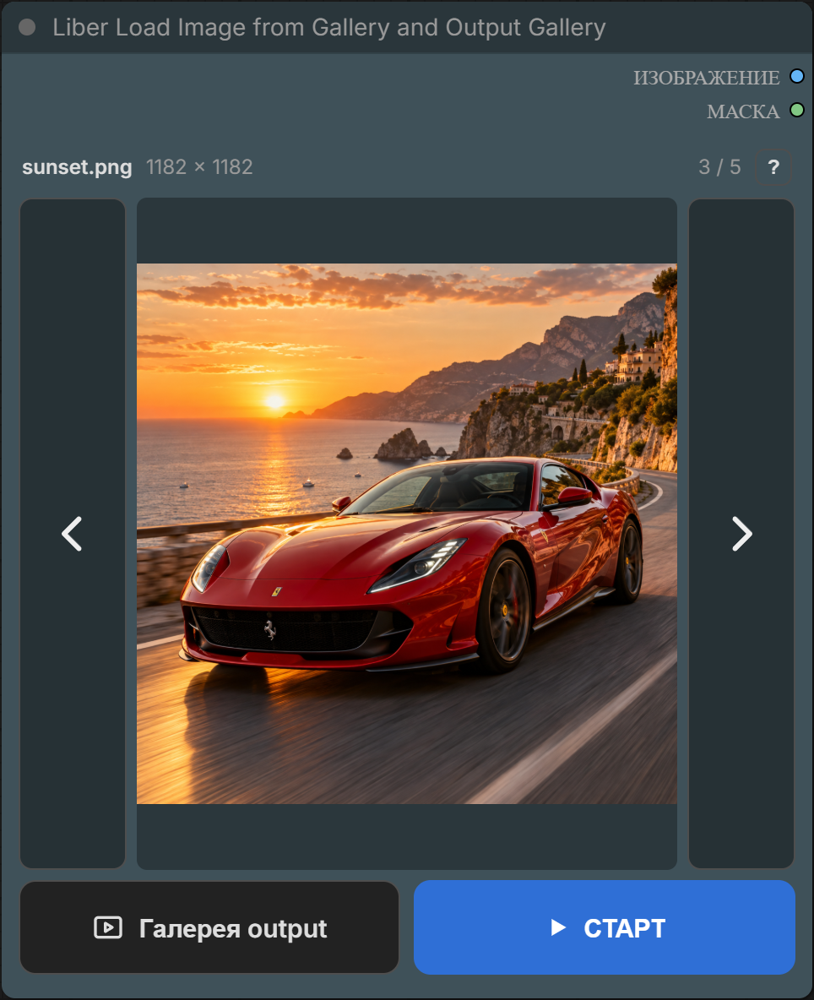
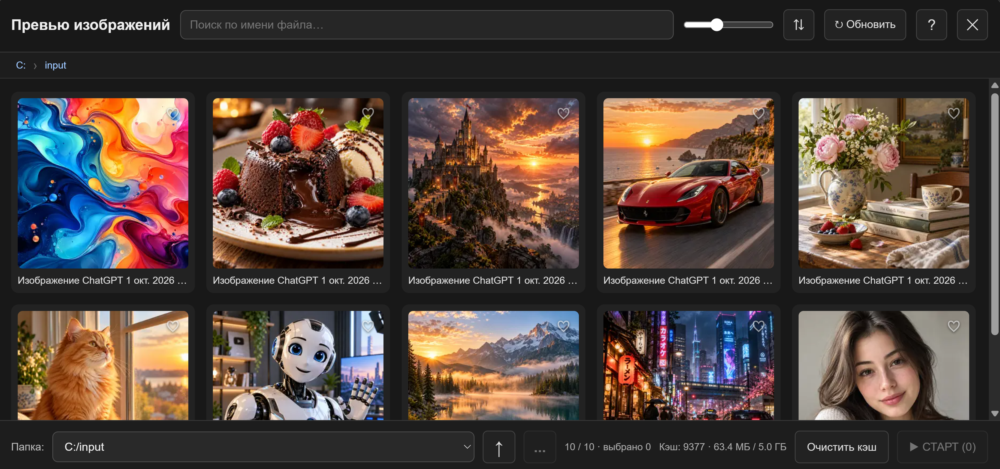
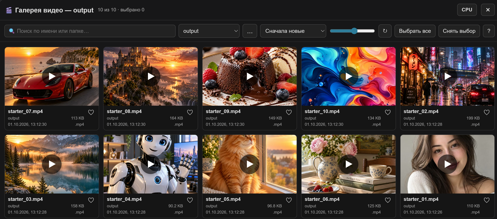

# Liber Load Image from Gallery and Output Gallery

<p align="center">
  <a href="./README.md">🇬🇧 English</a> &nbsp;|&nbsp; <strong>🇷🇺 Русский</strong>
</p>

Галерея изображений и видео для ComfyUI с быстрым просмотром, выбором файлов, увеличением, воспроизведением, полноэкранным режимом и поддержкой внешних папок.

Инструкция построена по сценариям: что вы хотите сделать, шаги, затем подробности. Встроенная инструкция использует те же сценарии и номера: 1–8 — изображения, 9–13 — видео.

## Быстрый старт

Добавьте ноду **Liber Load Image from Gallery and Output Gallery** в workflow.

В ноде:

- строка с именем файла, его разрешением, позицией в папке и **?** (инструкция);
- текущее изображение — клик открывает галерею изображений, удержание увеличивает, стрелки **‹ ›** по бокам листают;
- **Галерея output** — работа с видео;
- **СТАРТ** — запускает выбранные изображения по очереди;
- выходы **IMAGE** и **MASK**.

Нода выглядит и работает одинаково на классическом холсте и с включёнными в ComfyUI **Nodes 2.0** (Vue-ноды). Выбор файла и кнопка загрузки на самой ноде не показываются — они остаются в панели свойств ComfyUI справа.



## Изображения

### Сценарий 1. Выбрать одно изображение

1. Нажмите на превью изображения в ноде — галерея откроется в последней просмотренной папке.
2. Найдите файл через папки, поиск, сортировку или избранное.
3. Дважды нажмите на изображение или выделите его и нажмите **Enter**.

Изображение загрузится в ноду, а галерея закроется. Кнопка **✕** закрывает галерею без выбора; **Esc** и клик вне окна её не закрывают. Стрелки клавиатуры переключают карточки. При повторном открытии workflow последнее выбранное изображение восстанавливается автоматически.



### Сценарий 2. Листать изображения прямо в ноде

1. Нажимайте **‹** (предыдущее) или **›** (следующее) — высокие кнопки по бокам превью в ноде.

Список файлов загружается автоматически при открытии workflow и смене изображения — предварительно открывать галерею не нужно. Стрелки следуют сортировке и избранному галереи. Кнопки занимают всю высоту превью и всё свободное место по бокам изображения, поэтому в них легко попасть мышью или пальцем; если листать нечего (изображений меньше двух), они приглушены. Строка над изображением показывает позицию, например **3 / 12**.

Если изображение выбрано при включённых **Подпапках** (сценарий 7), стрелки листают тот же список вместе с подпапками.

### Сценарий 3. Рассмотреть изображение вблизи

1. Удерживайте левую кнопку мыши или палец на картинке в галерее или на превью в ноде около 0,3 секунды.
2. Изображение откроется на весь экран, увеличенным в 5 раз относительно вписанного в экран.
3. Не отпуская кнопку, водите мышью: где курсор на экране, та часть изображения и видна — левый верхний угол экрана показывает левый верхний угол изображения, центр — центр и так далее.
4. Отпустите кнопку, чтобы закрыть.

Показывается оригинал файла; пока он загружается, видна миниатюра. Если даже увеличенное изображение уже экрана по одной из сторон, по ней оно встаёт по центру. Короткий клик или тап работает как раньше, выделение не меняется. Пальцем держите саму картинку: удержание на подписи карточки или на пустом месте запускает рамку выделения (сценарий 4). Меню долгого нажатия браузера не появляется, и страница не прокручивается, пока вы водите пальцем.

### Сценарий 4. Запустить несколько изображений по очереди

1. Откройте галерею изображений.
2. Выделите изображения:
   - клик по карточке выделяет её или снимает выделение;
   - **Shift**+клик выделяет диапазон от предыдущего клика;
   - **пробел** переключает карточку в фокусе;
   - рамка, начатая на пустом месте между карточками; у верхнего или нижнего края галерея прокручивается сама;
   - на сенсорном экране удерживайте палец на подписи карточки или на пустом месте около 0,4 секунды и затем ведите (удержание на картинке увеличивает её, сценарий 3).
3. Нажмите **СТАРТ**.

Изображения последовательно отправляются в очередь ComfyUI в порядке выделения, на кнопке виден прогресс. Постановка продолжается, даже если закрыть галерею до того, как все задания добавились в очередь.

Выделение сохраняется при прокрутке и при повторном открытии галереи у той же ноды; **Обновить** его сбрасывает.

### Сценарий 5. Сохранить и повторно использовать набор изображений

1. Выделите нужные изображения.
2. Нажмите **Наборы ▾** в нижней панели.
3. Выберите **+ Создать из выделенных** и задайте имя.
4. Позже нажмите на название набора, чтобы восстановить его как текущее выделение, — или откройте **⋮** → **Старт**, чтобы сразу поставить весь набор в очередь в сохранённом порядке.

Набор хранит порядок выделения: при одиночных кликах это порядок кликов; если снять выделение с изображения и выбрать его снова, оно переместится в конец.

Откройте **⋮** рядом с сохранённым набором, чтобы изменить его:

- **Заменить текущим** — полностью заменить набор текущим выделением;
- **Добавить выделенные** — добавить в конец выделенные изображения, которых ещё нет в наборе;
- **Убрать выделенные** — удалить только выделенные изображения, которые входят в набор; выделенные изображения вне набора игнорируются;
- **Переименовать** — изменить название набора;
- **Удалить** — удалить сохранённый набор;
- **Старт** — сразу поставить весь набор в очередь, не загружая его в текущее выделение.

Набор может содержать изображения из разных папок, в том числе внешних. Наборы общие для разных workflow и нод и хранятся в `ComfyUI/user/image_gallery_sets.json`, а не внутри workflow.

### Сценарий 6. Открыть другую папку

1. Дважды нажмите на карточку папки или используйте строку пути над изображениями и **↑**, чтобы подняться выше.
2. Или нажмите кнопку папки рядом с **Папка:** внизу и выберите папку в дереве.
3. Кнопка **...** открывает системное окно выбора любой папки на компьютере.

В Windows **...** открывает окно выбора папки Проводника: оно следует светлой или тёмной теме Windows, чёткое на 4K-экранах, открывается в просматриваемой папке (из корня input — в папке, выбранной в прошлый раз) и запоминает свой размер и положение. У каждой галереи — своё. Окно открывается на компьютере, где запущен ComfyUI, поэтому при работе с ComfyUI на удалённом сервере оно бесполезно.

Карточка папки показывает до четырёх миниатюр и число изображений. Если в самой папке изображений нет, миниатюры берутся из вложенных папок. Превью загружаются по мере прокрутки и используют общий кэш миниатюр; **Обновить** перечитывает их.

Кнопка папки показывает имя и полный путь текущей папки. Она открывает дерево, как в панели навигации Проводника:

- **Недавние** — до 20 недавно открытых папок, внутренних и внешних, последняя сверху, у каждой полный путь;
- **input** — папка input ComfyUI и её подпапки;
- **Этот компьютер** — диски и любые папки на них.

Дерево открывается раскрытым до текущей папки, она подсвечена. **›** раскрывает уровень, клик по имени открывает папку. Работает и клавиатура: стрелки перемещают и раскрывают уровни, **Enter** выбирает, **Esc** закрывает дерево. Скрытые и системные папки не показываются, как в Проводнике.

### Сценарий 7. Видеть папку вместе со всеми подпапками одним списком

1. Нажмите **Подпапки** в верхней строке.
2. Все изображения папки и её подпапок любой глубины покажутся вместе, как будто лежат в этой папке; карточки папок скрываются.
3. Нажмите **Подпапки** ещё раз, чтобы вернуться к обычному виду.

В этом виде поиск и сортировка по имени смотрят на имя файла, поэтому изображения из разных подпапок перемешиваются; полный путь виден в подсказке при наведении на карточку. Выделение, наборы, **СТАРТ** и стрелки в ноде (сценарий 2) работают со всем списком, а в ноду попадает настоящий путь изображения.

Настройка запоминается. Скрытые и системные папки пропускаются. Показывается не больше 20 000 изображений — если список обрезан, это видно в счётчике внизу.

### Сценарий 8. Быстрее находить изображения и работать с ними

1. Введите часть имени файла в поле поиска.
2. Кнопка **⇅** сортирует по имени, дате или размеру файла, ползунок рядом с поиском меняет размер карточек (он запоминается).
3. **♡** в правом верхнем углу карточки добавляет изображение в избранное — избранные отмечаются **♥** и при любой сортировке остаются наверху; повторное нажатие снимает отметку.

Правый клик по изображению: **Сохранить изображение**, **Копировать изображение** и **Вставить изображение** — вставка кладёт скопированное изображение в открытую папку. Команда **Копировать изображение** одновременно сохраняет внутреннюю ссылку для галереи и, при локальном запуске ComfyUI в Windows, кладёт в буфер Windows исходный файл (Ctrl+V в Проводнике) и картинку (PNG / DIB / DIBV5 для графических редакторов и мессенджеров). Используется буфер компьютера с ComfyUI, а не удалённого браузера. Если Windows недоступна, браузерная вставка картинки возможна по мере поддержки браузера, но вставка файла в Проводник не гарантируется.

Миниатюры кэшируются на диске, размер кэша виден в счётчике внизу. **Очистить кэш** удаляет их, и они создаются заново при показе.

## Видео

### Сценарий 9. Открыть галерею видео

1. Нажмите **Галерея output** в ноде.
2. Выберите папку кнопкой папки рядом с поиском — то же дерево, что в галерее изображений, но с **output** вместо input, — или нажмите **...**, чтобы выбрать её в окне Проводника.
3. Найдите видео через поиск (по имени или папке), сортировку, избранное и ползунок размера карточек.

Новые видео появляются сами: пока галерея открыта, папка проверяется каждые несколько секунд и ещё раз сразу после завершения генерации. Во время генерации, воспроизведения или пока есть выделенные видео обновление ждёт и догоняет потом. **Обновить** перечитывает список сразу.

Миниатюры создаются в фоне; во время генерации это дольше, и галерея повторяет попытки сама. Если на карточке остаётся 🎬, наведите на неё курсор, чтобы увидеть причину (например, `ffmpeg not found`); та же причина пишется в консоль ComfyUI строкой `[ImageGallery] Output video thumbnail failed: …`.



### Сценарий 10. Смотреть видео

1. Клик по превью — воспроизведение или пауза.
2. Двойной клик — на весь экран; ещё один двойной клик — обратно.
3. В полноэкранном режиме справа доступны **⏮** предыдущее видео, **⏱** скорость воспроизведения, **⏭** следующее видео.

- Горизонтальный жест по видео перематывает назад или вперёд.
- Удерживайте левую кнопку мыши или палец на видео около 0,3 секунды, чтобы увидеть текущий кадр на весь экран, увеличенным в 5 раз, — так же, как в сценарии 3: видео продолжает играть (на паузе виден стоп-кадр), движение мыши или пальца смещает увеличенный участок, отпускание закрывает. Работает в GPU- и CPU-режиме, в карточке и на весь экран (кроме нижней панели управления), и не ставит видео на паузу. Если сразу повести пальцем, это по-прежнему перемотка жестом.
- Колесо мыши над видео меняет громкость; кнопка динамика выключает и возвращает звук. Ползунок громкости доступен даже на маленьком превью.
- Видео повторяется по кругу; скорость и громкость запоминаются.

После выхода из полноэкранного режима последнее видео продолжает играть в своей карточке с той же позиции — в том числе в избранном и в CPU-режиме, даже если перед выходом оно стояло на паузе.

Элементы управления скрываются после короткого бездействия; подвигайте мышью, коснитесь экрана или нажмите клавишу, чтобы показать их снова. На паузе интерфейс остаётся видимым.

### Сценарий 11. Смотреть видео, когда GPU занят

1. Включите **CPU** в верхней строке галереи.
2. Смотрите видео как обычно.
3. Ещё одно нажатие **CPU** возвращает обычный режим.

В CPU-режиме остаются те же действия: воспроизведение и пауза, перемотка, громкость, скорость, полный экран и переключение видео.

Если браузер не может декодировать кодек видео, плеер сам переходит на CPU — значок меняется с GPU на CPU, — а неподдерживаемый браузером звук перекодируется на лету через FFmpeg.

### Сценарий 12. Управлять видеофайлами

1. Выделите видео: клик по карточке под превью, рамка, **Shift**+клик для диапазона или **Выбрать все** (**Снять выбор** сбрасывает).
2. Правый клик по видео: воспроизвести, выделить, копировать, переименовать, показать в папке, удалить или **Открыть как workflow**.
3. Чтобы скопировать несколько видео, выберите копирование в контекстном меню и вставьте их в Проводнике Windows через **Ctrl+V**.

Несколько выделенных видео можно и удалить сразу; удалённые файлы попадают в корзину, если она доступна.

**Открыть как workflow** загружает workflow ComfyUI, сохранённый внутри файлов MP4, MOV, M4V и WebM.

### Сценарий 13. Пользоваться избранным

1. Нажмите сердечко под видео или **♡** на карточке изображения.

Избранные показываются первыми в своей галерее; повторное нажатие снимает отметку. Так часто используемые файлы легко найти, не теряя текущую позицию в галерее.

## Встроенная инструкция

**?** в ноде и кнопка **?** в каждой галерее открывают те же сценарии на выбранном языке: сценарии 1–8 — в галерее изображений, 9–13 — в галерее output.

## Язык

Интерфейс поддерживает **русский и английский**. Язык следует выбранному языку ComfyUI.

## Установка

Откройте терминал в папке `custom_nodes` ComfyUI:

```bash
git clone https://github.com/ATOM60/ComfyUI-LoadImageGallery.git
```

Перезапустите ComfyUI.

Название ноды: **Liber Load Image from Gallery and Output Gallery**.

## Обновление

Из папки установленной ноды:

```bash
git pull
```

Затем обновите frontend. Если обновление затрагивает backend-файлы (`.py`), перезапустите ComfyUI.

Если папка — не Git-клон (`git pull` пишет `not a git repository` или `invalid reference`), не копируйте новые файлы поверх старых: ComfyUI загружает каждый `.js` из `web/`, и удалённые в новой версии файлы продолжат работать. Закройте ComfyUI, удалите или переименуйте старую папку ноды и установите заново через `git clone`, как выше.

## Репозиторий

https://github.com/ATOM60/ComfyUI-LoadImageGallery
